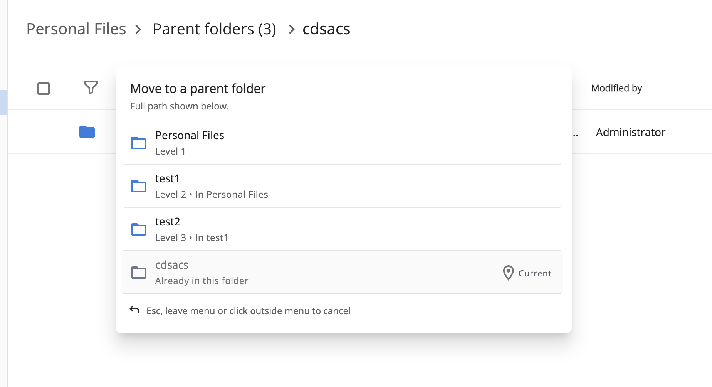

# [Compact Breadcrumb Component](../../../lib/content-services/src/lib/breadcrumb/compact-breadcrumb.component.ts "Defined in compact-breadcrumb.component.ts")

Displays breadcrumb as menu to allow see whole path. 



## Basic Usage

```html
<adf-compact-breadcrumb
    [nodes]="nodes"
    (dropped)="onDropped($event)"
    (navigate)="onNavigate($event)" />
```

## Class members

### Properties

| Name      | Type                                              | Default value | Description                                                   |
|-----------|---------------------------------------------------|---------------|---------------------------------------------------------------|
| nodes     | [`PathElementWithState[]`](#PathElementWithState) | `[]`          | The nodes to display in the breadcrumb.                       |
| fullWidth | `boolean`                                         | `false`       | If true, the breadcrumb menu will be displayed in full width. |

### Events

| Name     | Type                                                                                                                                                                                                                                                                                                                                                                                                     | Description                                                                                                       |
|----------|----------------------------------------------------------------------------------------------------------------------------------------------------------------------------------------------------------------------------------------------------------------------------------------------------------------------------------------------------------------------------------------------------------|-------------------------------------------------------------------------------------------------------------------|
| dropped  | [`OutputEmitterRef`](https://angular.dev/api/core/OutputEmitterRef)`<`[`CdkDragDrop`](https://material.angular.io/cdk/drag-drop/api#CdkDragDrop)`<`[`PathElement`](../../../lib/js-api/src/api/content-rest-api/docs/PathElement.md)`,` [`PathElement`](../../../lib/js-api/src/api/content-rest-api/docs/PathElement.md)`,` [`DataRow`](../../../lib/core/src/lib/datatable/data/data-row.model.ts)`>>` | Emitted when dragged item is dropped onto the breadcrumb. Emits drag and drop event.                              |
| navigate | [`PathElement`](../../../lib/js-api/src/api/content-rest-api/docs/PathElement.md)                                                                                                                                                                                                                                                                                                                        | Emitted when a breadcrumb item is clicked and navigation is triggered. Emits the PathElement of the clicked item. |


## Models

### PathElementWithState

#### Properties

| Name             | Type                                                                              | Description                                              |
|------------------|-----------------------------------------------------------------------------------|----------------------------------------------------------|
| node             | [`PathElement`](../../../lib/js-api/src/api/content-rest-api/docs/PathElement.md) | The node which name is displayed in the breadcrumb.      |
| current          | `boolean`                                                                         | If true, the node is the current node in the breadcrumb. |
| libraryContainer | `boolean`                                                                         | If true, the node is a library container.                |
| description      | `string`                                                                          | The description of path for this node.                   |

## See also

-   [Breadcrumb Component](./breadcrumb.component.md)
